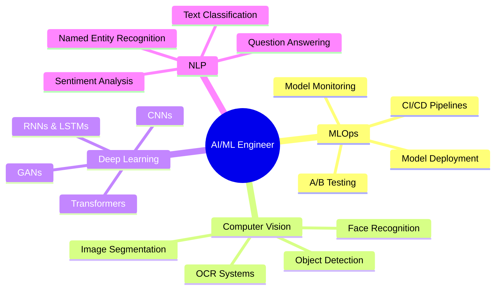

<h1 align="center">
  
</h1>

  <strong>AI/ML Engineer &bull; Deep Learning Specialist &bull; Multi-Agent Systems Architect</strong>

  
  
  
  
  

---

## 👩‍💻 About Me

- 🔬 **Core Focus:** Machine Learning, Deep Learning, Multi-Agent Autonomous Systems, and Computer Vision.
- 💡 **Engineering Philosophy:** *Believe in meaningful builds that solve real-world problems over vanity metrics.*
- 🛠️ **What I Build:** End-to-end intelligence platforms spanning demand forecasting, operations research (MILP), visual document processing (PaddleOCR-VL), guarded natural-language text-to-SQL querying, and multi-agent QA pipelines.
- ⚙️ **Production Mindset:** Clean architecture, containerized microservices, comprehensive evaluation benchmarks, and transaction-level data security.

---

## 📈 ML/DL Specializations

---

## 🧠 Machine Learning & Deep Learning Stack

<h4 align="center">Core ML/DL Frameworks</h4>

  
  
  
  
  

<h4 align="center">Computer Vision &amp; Image Processing</h4>

  
  
  
  

<h4 align="center">Natural Language Processing</h4>

  
  
  
  

<h4 align="center">Data Science &amp; Analysis</h4>

  
  
  
  
  

<h4 align="center">MLOps &amp; Deployment</h4>

  
  
  
  
  

<h4 align="center">Development Tools</h4>

  
  
  
  
  

---

## 🚀 Featured Projects

### 🛒 [RetailMind AI — Explainable, Adaptive Multi-Agent Retail Decision Intelligence Platform](https://github.com/boomiikas/RetailMindAI)
> **Enterprise-grade retail supply-chain decision intelligence platform bridging predictive forecasting and autonomous execution.**

- **Quantile Predictive Engine:** Dual-mode forecasting modeling granular quantile demand distributions ($P_{10}, P_{50}, P_{90}$) using HistGradientBoosting and statistical SDOWF baselines to capture supply uncertainty.
- **Ripple Intelligence Service:** NetworkX directed acyclic graph (DAG) engine tracking inventory shocks, multi-store dependencies, and cascading stockout losses across retail nodes.
- **Prescriptive Optimization:** Formulates and solves Mixed-Integer Linear Programs (MILP) with Pyomo & HiGHS to recommend maximum-profit inventory interventions and reorder logistics.
- **Cognitive Agent Layer:** LangGraph + Groq LLM brain (`Retail Intelligence Agent` & `Decision Communication Agent`) with WhatsApp / Telegram manager approval loops and automated dynamic replanning.
- **Tech Stack:** `Python 3.13` &bull; `PyTorch` &bull; `Scikit-Learn` &bull; `Pyomo (HiGHS MILP)` &bull; `NetworkX` &bull; `LangGraph` &bull; `FastAPI` &bull; `Supabase PostgreSQL` &bull; `React 18` &bull; `Vite`

---

### 🧪 [AgentQA — Multi-Agent Software Testing & Bug Analysis Platform](https://github.com/boomiikas/Multi-Agent-Software-Testing-and-Bug-Analysis-Platform-)
> **Autonomous software quality assurance platform powered by a 9-stage LangGraph multi-agent pipeline and self-healing test automation.**

- **Multi-Agent Orchestration:** 8 specialized collaborative agents parsing SRS documents, generating test suites, executing end-to-end tests, and synthesizing executive quality reports.
- **Live UI & API Automation:** Headless Chromium execution via Playwright with automated failure screenshots, alongside HTTPX live API testing protected by strict SSRF destination validation.
- **Static Security Auditing:** Subprocess-isolated scans with Bandit (Python AST vulnerability analysis) and pip-audit (PyPI CVE database validation).
- **Evidence-Based RCA & Self-Healing:** Classifies test failures across 7 root-cause categories based on real execution telemetry, triggering bounded exponential-backoff retries.
- **Tech Stack:** `Python 3.13` &bull; `FastAPI` &bull; `LangGraph` &bull; `Playwright` &bull; `HTTPX` &bull; `Bandit` &bull; `pip-audit` &bull; `MongoDB Atlas` &bull; `React` &bull; `Vite` &bull; `Ollama`

---

### 📄 [InvoiceAI — Handwritten & Printed Invoice Text Extraction & Analytics](https://github.com/boomiikas/Handwritten-invoice-text-extraction)
> **AI-powered document processing and business intelligence platform automating invoice data extraction, validation, and analytics.**

- **Visual OCR & LLM Post-Processing:** Two-stage intelligent document processing pipeline using PaddleOCR-VL for visual recognition and local LLaMA 3 for structured key-value normalization.
- **Interactive Review Workflow:** Form-based validation interface with editable fields, automated tax calculations (CGST, SGST, IGST), and an immutable audit modification history.
- **Business Intelligence Suite:** Real-time dashboards visualizing monthly billing volume trends, OCR error distributions, and buyer revenue contributions.
- **Conversational Assistant (NiBo):** Natural-language financial assistant for querying invoices, synthesizing revenue summaries, and generating downloadable PDF reports via ReportLab.
- **Tech Stack:** `Python` &bull; `PaddleOCR-VL` &bull; `LLaMA 3 (Ollama)` &bull; `Flask` &bull; `MongoDB Atlas` &bull; `React` &bull; `Vite` &bull; `ReportLab` &bull; `OAuth 2.0`

---

### 🎓 [SkillQuery — Student Skills Intelligence Assistant](https://github.com/boomiikas/skillquery) &bull; [Live Demo](https://ps-bot-six.vercel.app/)
> **Natural-language semantic querying and course taxonomy analytics platform with web dashboard and WhatsApp Cloud API support.**

- **Semantic Skill Taxonomy:** Intelligently maps domain concepts (*AI/ML*, *DevOps*, *Backend*, *DSA*) and course aliases to verified PostgreSQL completions without relying on rigid name matching.
- **Deterministic Invariant Guarantees:** Ensures $\text{COUNT(DISTINCT roll\_number)} = \text{Unique Listed Students} = \text{Exported Students}$ with responsive 50-per-page pagination and CSV/Google Sheets exports.
- **Dynamic Ranking & Cohort Sizing:** Parses user ranking limits (*"Top 50 students who cleared C Level 2"*) using PostgreSQL window functions with transparent deterministic tie-breaking.
- **Security & AI Evaluation:** Strict transaction-level read-only guards (`SET TRANSACTION READ ONLY`), statement timeouts, and a 60-case benchmark evaluation suite with LLM-as-judge scoring.
- **Tech Stack:** `Python` &bull; `FastAPI` &bull; `PostgreSQL` &bull; `Groq LLM` &bull; `WhatsApp Cloud API` &bull; `JavaScript` &bull; `HTML5/CSS3` &bull; `Vercel`

---

## 📊 GitHub & Algorithmic Stats

  
  

  

  

  

---

## 🤝 Connect with Me

  
  
  
  
  

