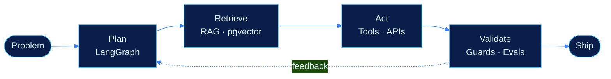

 

 

<h2 align="center">🤖 &nbsp;Who I Am</h2>

I'm a **Computer Science and Engineering undergraduate at Bannari Amman Institute of Technology**. I like building AI systems that don't stop at a demo: agents that reason over data, call tools, and hand back something a person can actually use.

- 🧠 Building AI-powered applications, RAG pipelines, and multi-agent systems
- ⚙️ Developing full-stack apps, REST APIs, and backend architectures
- 📈 Exploring machine learning, system design, and intelligent automation
- 🧩 Sharpening problem-solving through Data Structures & Algorithms

> **Build with purpose. Engineer with clarity. Keep improving.**

 

<h2 align="center">🔁 &nbsp;How I Build Agents</h2>

 

<h2 align="center">🚀 &nbsp;Projects</h2>

<table>
<tr>
<th align="left">Project</th>
<th align="left">What it does</th>
<th align="left">Built with</th>
</tr>
<tr>
<td><a href="https://github.com/boomiikas/RetailMindAI"><b>RetailMind AI</b></a> Multi-agent retail decision intelligence</td>
<td>Quantile demand forecasting, NetworkX DAG cascading-loss analysis, and Pyomo MILP optimization, with interactive WhatsApp approvals.</td>
<td><code>PyTorch</code> <code>LangGraph</code> <code>Pyomo</code> <code>FastAPI</code> <code>PostgreSQL</code> <code>React</code></td>
</tr>
<tr>
<td><a href="https://github.com/boomiikas/Multi-Agent-Software-Testing-and-Bug-Analysis-Platform-"><b>AgentQA</b></a> Autonomous software testing platform</td>
<td>An 8-agent LangGraph pipeline with Playwright browser automation, live HTTPX API testing with SSRF guards, Bandit security scans, and evidence-based root cause analysis.</td>
<td><code>LangGraph</code> <code>Playwright</code> <code>HTTPX</code> <code>FastAPI</code> <code>MongoDB</code> <code>Ollama</code></td>
</tr>
<tr>
<td><a href="https://github.com/boomiikas/skillquery"><b>SkillQuery</b></a> Student skills &amp; course analytics assistant</td>
<td>Natural-language querying over student academic records with guarded text-to-SQL, Groq LLM, course taxonomy analytics, and WhatsApp Cloud API support.</td>
<td><code>FastAPI</code> <code>PostgreSQL</code> <code>Groq</code> <code>WhatsApp API</code> <code>AI Evals</code></td>
</tr>
<tr>
<td><a href="https://github.com/boomiikas/Handwritten-invoice-text-extraction"><b>InvoiceAI</b></a> Invoice extraction &amp; business analytics</td>
<td>Extracts structured data from handwritten and scanned invoices using PaddleOCR-VL and local LLaMA 3, with automated tax validation and live BI dashboards.</td>
<td><code>PaddleOCR-VL</code> <code>LLaMA 3</code> <code>Flask</code> <code>MongoDB</code> <code>React</code></td>
</tr>
</table>

 

<h2 align="center">🛠️ &nbsp;Tech Stack</h2>

**Languages**

**Frontend · Backend · Databases**

**AI · Data · Developer Tools**

**Agents & LLM Tooling**

 

<h2 align="center">📊 &nbsp;Activity</h2>

 

 

 

<b>Let's build something intelligent together.</b>

<a href="https://www.linkedin.com/in/boomiikas05/">LinkedIn</a> · <a href="mailto:boomikas2007@gmail.com">Email</a> · <a href="https://leetcode.com/boomikas">LeetCode</a>

